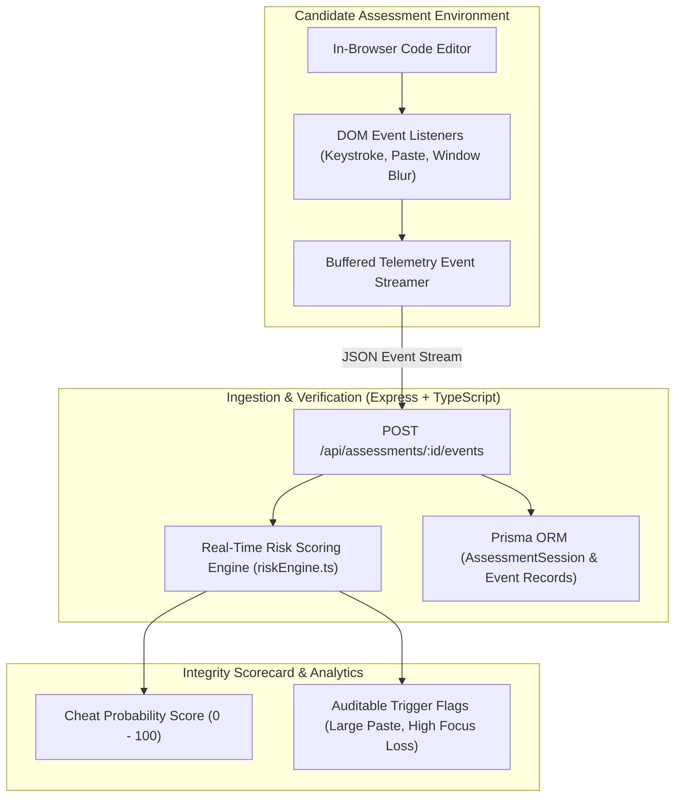

# 🎓 Assessment Integrity & Real-Time Code Proctoring Engine

[](https://nodejs.org/)
[](https://www.typescriptlang.org/)
[](https://prisma.io/)
[]()
[](LICENSE)

A real-time behavioral telemetry and anti-cheat assessment engine designed for technical coding exams. Detects abnormal paste spikes, browser blur / focus-loss sequences, and typing velocity deviations to generate auditable integrity scores without invasive webcam monitoring.

---

## 📐 System Architecture



---

## 🌟 Key Capabilities

1. **Non-Invasive Keystroke Dynamics:**
   * Tracks incremental character deltas (`TYPE` events) versus external clipboard dumps (`PASTE` & `LARGE_PASTE` events).
   * Flags suspicious burst typing velocity exceeding standard human cadence.

2. **Window Focus Loss Tracking:**
   * Detects `blur` and `focus` events when candidates switch to secondary tabs (e.g. ChatGPT, documentation, or IDEs) and calculates total off-screen duration.

3. **Deterministic Integrity Risk Scoring:**
   * `riskEngine.ts` computes an auditable score ($0 - 100$) paired with discrete behavioral deduction reasons:
     * High paste-to-type character volume ratio
     * Repeated window blur interruptions
     * Multi-line paste injections without preceding draft iterations

4. **Split-Screen Proctoring Dashboard:**
   * Real-time dark UI in `public/index.html` displaying live candidate code, event stream timeline, and dynamic risk meters.

---

## 📁 Repository Structure

```text
assessment-integrity-platform/
├── prisma/
│   └── schema.prisma        # Database models for sessions & telemetry events
├── public/
│   └── index.html           # Real-time candidate IDE & proctoring dashboard
├── src/
│   ├── riskEngine.ts        # Pure deterministic risk assessment algorithm
│   └── server.ts            # Express REST API & event ingestion endpoints
├── package.json             # TypeScript & Prisma configuration
└── tsconfig.json            # Strict TypeScript configuration
```

---

## 🚀 How to Run

1. **Install Dependencies:**
   ```bash
   npm install
   ```

2. **Initialize Database:**
   ```bash
   npx prisma db push
   ```

3. **Start Assessment Server:**
   ```bash
   npm run dev
   ```
   *Access the candidate test environment at `http://localhost:3000`.*

---

## ⚖️ Intellectual Property & License

**Copyright (c) 2026 Kartik. All Rights Reserved.**

This repository and its source code are published for **viewing, evaluation, and portfolio demonstration purposes only**. No permission is granted to reproduce, distribute, modify, deploy, or commercially exploit this software. See the [LICENSE](LICENSE) file for complete legal terms.
